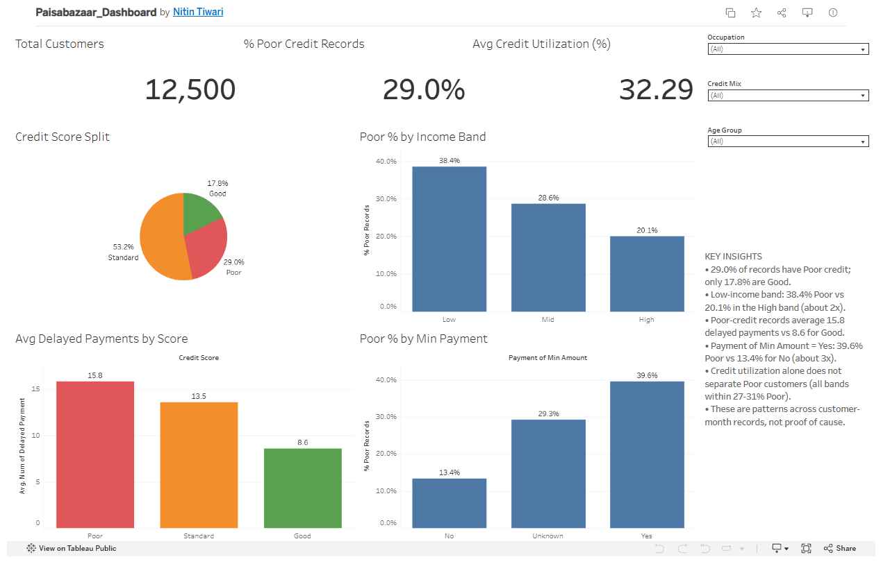

# Paisabazaar Credit Risk Dashboard

An interactive Tableau Public dashboard that shows which customer behaviours are linked with a Poor credit score. It is the dashboard stage of my Python EDA project.

**Live dashboard:** https://public.tableau.com/app/profile/nitin.tiwari2142/viz/Paisabazaar_Dashboard/PaisabazaarCreditRiskDashboard
**Related EDA project:** <link to your EDA repo>

## Business Question
Which financial behaviours are most associated with a Poor credit score, and which customer groups may need closer risk review?

## Dataset
- 100,000 records and 28 columns (30 after cleaning)
- 12,500 unique customers over 8 months, so each row is one customer-month record
- Target: Credit Score (Poor, Standard, Good)

## Tools
Python (Pandas, NumPy), Google Colab, Tableau Public

## Data Cleaning
- Checked duplicates and null values (none found)
- Removed ID, Name and SSN (Tableau Public data is public)
- Converted Age and count columns to integers
- Replaced 12,007 invalid "NM" values in Payment_of_Min_Amount with "Unknown"
- Created Age_Group, Income_Band, Utilization_Band, Delay_Band and Debt_to_Income

## Dashboard
7 visuals (3 KPIs, 1 pie chart, 3 bar charts) and 3 filters (Occupation, Credit Mix, Age Group).

## Key Findings
- 29.0% of records have a Poor score; 53.2% are Standard and 17.8% are Good
- Low income band: 38.4% Poor vs 20.1% in the High band (about 2x)
- Poor-credit records average 15.8 delayed payments vs 8.6 for Good
- Payment of Min Amount = Yes: 39.6% Poor vs 13.4% for No (about 3x)
- Credit utilization alone does not separate Poor customers (all bands within 27-31% Poor)
- Occupation does not drive risk: the Poor share ranges only from 26.3% to 30.6%

## Business Impact
Delayed payments and minimum-payment behaviour can work as early-warning signals. The Low income group may benefit from extra guidance or more careful credit limits. Credit decisions should combine several signals instead of one.

## Limitations
- Each row is a customer-month record, so percentages describe records, not customers
- The patterns show association, not proof of cause
- There is no fraud label in the data
- The exact definition of Payment of Min Amount should be confirmed from the data dictionary

## Next Steps
Predictive model for credit score category, anomaly detection, and a high-risk customer watchlist.

## Files
- `notebooks/` cleaning notebook
- `docs/` project documentation (PDF)
- `screenshots/` dashboard images
